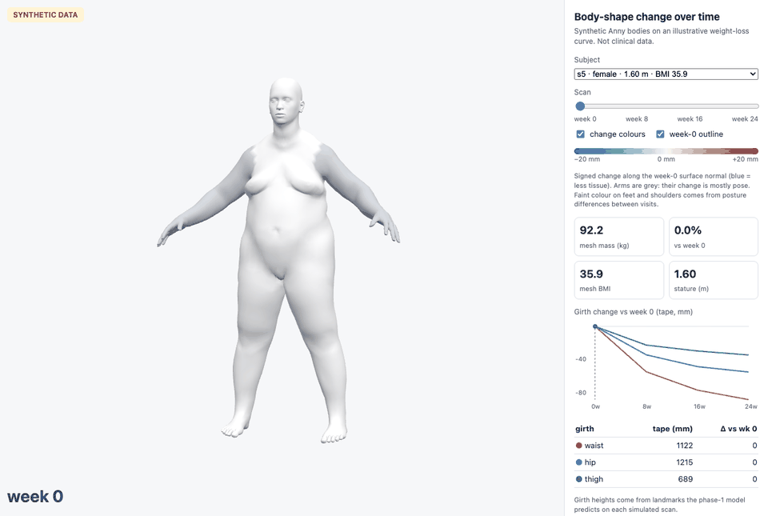
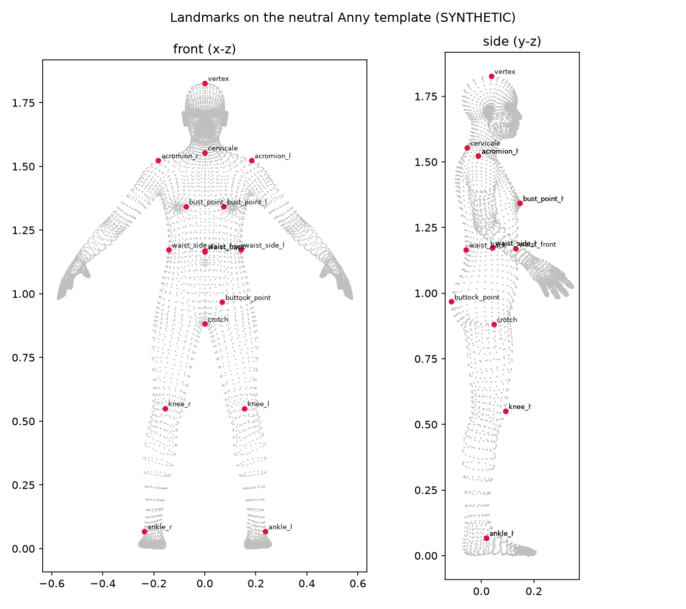
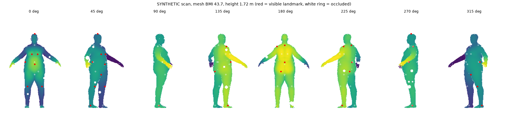

# body3d-landmarks

Landmark detection and body-shape change tracking on 3D body scans, built around two
problems a 3D body-scanning company faces: **landmarks that stay accurate across body
types**, and **showing how a body changes over time** from mesh/STL scans.

> **All data here is synthetic.** Bodies come from the open [Anny](https://github.com/naver/anny)
> parametric model, and the scanner is simulated (turntable depth camera with invented noise
> and sway). The numbers show the method and engineering, **not** any real scanner's accuracy.

**Live demo: [zeussilver.github.io/body3d-landmarks](https://zeussilver.github.io/body3d-landmarks/)** (3D viewer, 6 synthetic subjects × 4 scans).



## Results

2,000-body test set, 400 per mesh-BMI band, sex-balanced, mean 3D error over 16 landmarks
in mm, mean ± std over 3 training seeds ([`results/summary.json`](results/summary.json)):

| model | overall | BMI <18.5 | 18.5–25 | 25–30 | 30–35 | ≥35 |
|---|---|---|---|---|---|---|
| B0 rigid template + ICP + nearest point | 31.37 | 20.85 | 22.48 | 27.04 | 37.09 | 49.40 |
| E0 trained on the full range | 2.78 ± 0.05 | 3.02 | 2.80 | 2.73 | 2.62 | 2.72 |
| E1 trained on BMI 18.5–27 only | 5.35 ± 0.14 | 3.69 | **2.64** | 3.03 | 5.74 | **11.63 ± 0.54** |
| E2 = E1 + normal-offset inflation | 5.41 ± 0.11 | 4.13 | 2.86 | 3.42 | 6.10 | 10.54 ± 0.18 |
| E3 = E1 + shape-space extrapolation | 3.02 ± 0.11 | 3.41 | 2.71 | 2.81 | 2.95 | **3.20 ± 0.12** |

- **The gap.** Trained only on BMI 18.5–27, the model is 4.4× worse at BMI ≥ 35 than in
  range (11.63 vs 2.64 mm). The crotch, waist front and buttock fail first.
- **The fix.** E3 closes **95% ± 1%** of the E1 → E0 gap on the BMI ≥ 35 band (per seed
  95.0 / 95.6 / 93.1%), and in-range error moves by only +0.06 mm. Caveat: the
  extrapolated training bodies come from the same generator as the test bodies, so this
  is an optimistic upper bound.
- **What did not work.** E2 (inflate the mesh along its normals, a model-free trick
  that would also work on labelled real scans) closes only 12% ± 6%. It helps where extra
  tissue really is a normal offset (buttock 19.1 → 12.3 mm, mean of seeds, BMI ≥ 35) and
  hurts where weight changes shape differently (waist front 21.2 → 29.7 mm).
- E0 is 91% below the rigid-template baseline, with PCK@10 mm of 100%. Baseline 95%
  bootstrap CI: 30.80–31.96 mm.

## How it works

**Bodies** ([`bodies.py`](src/body3d/bodies.py)): adults aged 20–70 from Anny's
WHO-calibrated sampler, plus 9 local shape controls (waist, hips, stomach, thighs, …)
and arm/stance jitter. Mesh BMI (volume × 980 kg/m³ / height²) is kept between 15 and 50.

**Landmarks** ([`landmarks.py`](src/body3d/landmarks.py)): 16 points in the style of
ISO 8559-1 (vertex, cervicale, acromion, bust, waist ×4, buttock, crotch, knees, lateral
malleoli). Each is a fixed vertex index, picked once by geometric rules on the neutral
template, so the same index is the same anatomical point on every body.


**Scanner** ([`scanner.py`](src/body3d/scanner.py)): 8 orthographic depth views on a
turntable, 256×160 px at 8.5 mm. It adds random facing and centre offset, independent
per-view sway (drift, lean, twist, arm drift), grazing-angle dropout, blob holes,
Gaussian noise and 1 mm quantisation. The rasteriser matches trimesh ray casting
exactly: 248,396 pixels, max difference 2.6e-11 mm, 26.2 ms per body on CPU
([`results/scanner_check.json`](results/scanner_check.json)). Horizontal cameras see the
crotch only as a silhouette. It is observable in fewer than 2 views for 49% of BMI ≥ 35
bodies, because the thighs touch.


**Model** ([`model.py`](src/body3d/model.py), [`train.py`](src/body3d/train.py)): one
1.96 M-parameter U-Net shared by all views predicts 16 heatmaps and per-view confidences.
Soft-argmax gives sub-pixel positions. In view θ a point lands at
u = x·cosθ − y·sinθ, w = z, so the 3D landmark is a closed-form, differentiable,
confidence-weighted least-squares solve, and the loss is the 3D error in mm. Training
uses 8,000 bodies with scans rendered on the fly, 10 epochs on Apple MPS (46–67 min per run).
Placement, noise and sway are drawn from (run seed, DataLoader worker seed, body index), and the
8 workers persist across epochs, so each body cycles through at most 8 perturbations rather than
getting a new one every epoch. Models are selected on a validation split
from the same distribution as training, and the test set is scored once.

**Evaluation** ([`evaluate.py`](src/body3d/evaluate.py)): per-landmark error,
PCK@10/20 mm, strata by BMI, sex and height band, subject-level bootstrap CIs, worst
band and gap.

## Body-shape change over time

[`change.py`](src/body3d/change.py) builds 6 synthetic subjects (start mesh BMI
30.1–37.4) with 4 visits each (weeks 0, 8, 16, 24). Each loses 10.0% of mesh mass along
an illustrative fast-then-plateau curve, is re-positioned on the turntable at every
visit, and is exported as binary STL ([own reader/writer](src/body3d/stl.py)).

- **Change maps, two ways.** (A) With vertex correspondence: Kabsch on head and shins,
  then signed displacement along the week-0 normals. (B) From STL files alone:
  point-to-plane ICP, then signed distance to the nearest tangent plane. A and B agree
  within 0.08–1.81 mm (median per scan, 18 scans).
- **Girths.** Mesh-plane slicing at waist, hip and thigh, with contour and convex-hull
  ("tape") length. Heights come from landmarks the E0 model predicts on each simulated
  scan; against ground-truth heights the tape differs by 0.75 mm on average. Week-24
  waist change: −50.9 to −88.1 mm ([`results/change_check.json`](results/change_check.json)).
- **Viewer** ([`viewer/`](viewer)): three.js + `STLLoader`, timeline slider, ±20 mm
  diverging colour map (arms greyed out, since pose dominates there), a translucent
  week-0 shell and a girth chart.

## C# / .NET service and S3

[`dotnet/`](dotnet) is an ASP.NET Core minimal API on .NET 10 (`Body3d.Core`,
`Body3d.Api`, 12 xUnit tests):

- **Own C# implementation** of the STL parser, rasteriser, slicer and girths, plus
  point-to-plane ICP with a k-d tree.
- **Landmarks** come from the CNN exported to ONNX and run in ONNX Runtime; soft-argmax
  and triangulation are in C#.
- **Python-vs-C# parity** on 3 scans ([`results/parity_csharp.json`](results/parity_csharp.json)):
  - depth: 100% of pixels within 1 mm, max difference 6.0e-5 mm;
  - landmarks: max difference 0.0032 mm;
  - girths: max difference 6.3e-5 mm.
- **Endpoints:**
  - `POST /scans/landmarks` and `POST /scans/girths` take an STL body;
  - `POST /scans/change` takes two STLs;
  - `PUT /subjects/{id}/scans/{week}` and `GET /subjects/{id}/change?from=0&to=24` use a
    local or **S3** scan store.
- **S3 test** in ap-southeast-2 ([`results/s3_integration.json`](results/s3_integration.json)):
  private bucket (SSE-S3, TLS only, 30-day expiry). 24 STLs uploaded through the API,
  SHA-256 checksums verified, and girth changes computed from S3 within 0.42 mm (mean) of
  the Python pipeline.

## Reproduce

```bash
uv sync                                          # Python 3.12, PyTorch, anny==0.6.1
gh release download v0.1 -R zeussilver/body3d-landmarks -p best.pt -D runs/e0_s0  # trained E0 (or train it)
uv run python -m body3d.data                     # fixed test/val scans + training meshes
uv run python -m body3d.baseline                 # B0
uv run python -m body3d.train --cond e1 --seed 0 # conditions e0..e3, seeds 0..2
uv run python -m body3d.report                   # results/summary.json
uv run python -m body3d.change                   # trajectories, change maps, viewer data
uv run python -m http.server 8790 --directory viewer
uv run python -m body3d.export && (cd dotnet && dotnet test)
(cd dotnet && dotnet run --project src/Body3d.Api)  # then POST an STL (mm, z up) to /scans/girths
uv run pytest                                    # 44 tests
```

## Limitations

- Synthetic bodies and an invented sensor/sway model, with no real-scanner calibration.
  Absolute mm are optimistic: labels are exact vertices and the generator has only 18
  degrees of freedom. The relative gap and its closure are the meaningful results.
- Fixed-vertex landmarks can drift from where a human measurer would place them on very
  large bodies. Orthographic cameras are a simplification.
- The weight-loss trajectories are illustrative only and are not clinical data.

## Credits

Code in this repository: MIT ([LICENSE](LICENSE)). Body model: Anny by NAVER LABS Europe (code Apache-2.0, MakeHuman/MPFB2 assets CC0;
[arXiv:2511.03589](https://arxiv.org/abs/2511.03589)). Only the default `anny`
topology is used, never the non-commercial SMPL-X one. No body-model files are stored
in this repository. Design notes and the full experiment log are in
[`docs/PLAN.md`](docs/PLAN.md).
